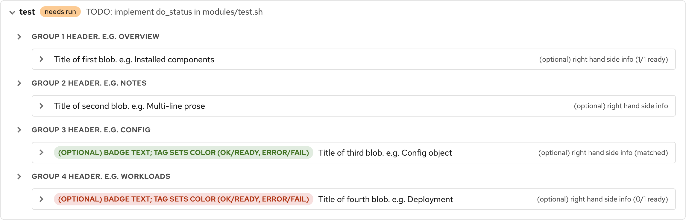

# What is a module

A **module** is used to perform one setup step for the demo lab. It is a shell/Python program that can do anything you like. The GUI acts as an orchestrator and renderer that talks to modules using the hooks listed below.

- **Triggers:** The module is triggered to **run** (install) or **uninstall**, both with a **dry-run** option.
- **Output:** The module provides structured **status** info for the GUI to render.

Template files ([`module-skeleton.sh`](https://github.com/boazmichaely/ACS-demo-setup/blob/main/templates/module-skeleton.sh), [`module-helper.py`](https://github.com/boazmichaely/ACS-demo-setup/blob/main/templates/module-helper.py)) are provided to start you off, and a common Python library ([`lib/central.py`](https://github.com/boazmichaely/ACS-demo-setup/blob/main/lib/central.py), [`lib/openshift.py`](https://github.com/boazmichaely/ACS-demo-setup/blob/main/lib/openshift.py), [`lib/demo_policies.py`](https://github.com/boazmichaely/ACS-demo-setup/blob/main/lib/demo_policies.py)) provides a unified way to use admin credentials for the associated Central and OpenShift clusters in your lab (and to stamp demo policies with category `DEMO`).

You can also use the [ms-demo](https://github.com/boazmichaely/ACS-demo-setup/blob/main/modules/ms-demo/ms-demo.sh) module as a lightweight example.


| Flag | What the module must do (Module Contract) |
|------|-------------------------------------------|
| `--help` | Markdown: purpose, optional **Flags**, **Status Info**, **Pre Conditions** (usually `none`; only call out another installed tool or prior module), and **Side effects**. Prefer **constants and CLI flags** over module-specific env vars. Do not dump tool-wide `ACS_*` credential paths or repeat shared lab/`oc` fluff. |
| `--status` | Report whether this step is already done. Print both a short summary line and detailed Status folds (described later). Both outputs are required. |
| `--run` | Apply the step. Running it again when nothing has drifted must still succeed. |
| `--run --dry-run` | Describe what `--run` would change, without changing the cluster or Central. |
| `--uninstall` | Remove what this module created, or refuse with a clear error. |
| `--uninstall --dry-run` | Describe what `--uninstall` would remove, or refuse the same way. |

The rest of this page is the recipe: catalog row, skeleton, status shape, credentials, then smoke test.

## What you must create

A module shows up in the GUI and the CLI orchestrator only when both exist:

1. An executable script at `modules/<id>/<id>.sh`.
2. A matching row in [`config/modules.json`](https://github.com/boazmichaely/ACS-demo-setup/blob/main/config/modules.json).

The orchestrator reads the catalog, then runs `modules/<id>/<id>.sh`. A catalog row without a script still appears as **not installed** (handy as a placeholder). A script with no catalog row is invisible.

## Fast path

```bash
# 1. Choose a short kebab-case id, for example my-feature
ID=my-feature

# 2. Copy the shell skeleton (always required)
mkdir -p "modules/${ID}"
cp templates/module-skeleton.sh "modules/${ID}/${ID}.sh"
chmod +x "modules/${ID}/${ID}.sh"

# 3. Edit the copy: set MODULE_ID, fill in usage() and the do_* functions.
#    Search for TODO. The skeleton’s emit_status_sections() is the teaching
#    example for Status folds; replace it with real lab checks when ready.

# 4. Add a row to config/modules.json (see “Catalog entry” below).
#    Without that row, the module will not appear in the GUI.

# 5. Smoke-test from the terminal
./modules/${ID}/${ID}.sh --help
./modules/${ID}/${ID}.sh --status
./scripts/acs-setup.sh --status --module "${ID}"
```


## Catalog entry

Add one object to the `modules` array in [`config/modules.json`](https://github.com/boazmichaely/ACS-demo-setup/blob/main/config/modules.json). Array order is GUI order and the default full-install order. If this module must run after another, put that module’s `id` in `dependsOn`.

```json
{
  "id": "my-feature",
  "label": "Short description for the Description column",
  "dependsOn": [],
  "statusComplexity": 5,
  "impactPlanes": ["secured-cluster"],
  "securedClusterPolicy": "single",
  "runSummary": "What Install will do (1-3 short lines for the confirm modal).",
  "uninstallSummary": "What Uninstall will remove (1-3 short lines; separate from run)."
}
```

- `id` is the module key. It must match `modules/<id>/<id>.sh`, CLI `--module`, other modules’ `dependsOn`, and the **Module** column. Do not repeat the id inside `label`.
- `statusComplexity` is an integer **1-10** hint for GUI status refresh order (lower = cheaper `--status`, refreshed first). Default to `5` if unsure; heavy OpenShift/Central probes (for example virt) belong near 8-10.
- `label` is Description-column text only. Plain sentence or phrase, capitalized. Not `id - description`.
- `impactPlanes` declares where the module does work (GUI **Type** column; see [Planes and multi-SC](#planes-and-multi-sc)). Required for new modules.
- `securedClusterPolicy` - required when `impactPlanes` includes `secured-cluster`. Values: `single` (default for new modules; refuse multi-SC fan-out), `multi-warn` (allow multi-SC; GUI warns if already present elsewhere), `multi` (multi-SC is normal). Omit for Central-only modules. See [Secured-cluster policy](#secured-cluster-policy).
- `runSummary` / `uninstallSummary` - required for GUI confirm modals (R-GUI-5). Two **separate** strings: Install vs Uninstall. Static intent only (no live cluster probe). The GUI always shows a confirm popup before Run or Uninstall; these fields are the “what will happen” copy.
- Prefer `my-feature.sh` over `07-my-feature.sh`.

## Python helper (required for Central)

The entrypoint is always `modules/<id>/<id>.sh`. Whether you also need a `.py` file depends on what the module talks to:

- **OpenShift only** (`oc`) - shell is enough. Call `python -m lib.openshift` for login, then use `oc` (see [Credentials and auth](#credentials-and-auth) below).
- **Central** (RHACS HTTP API) - you need a Python helper. Shared Central auth lives only in [`lib/central.py`](https://github.com/boazmichaely/ACS-demo-setup/blob/main/lib/central.py); there is no bash equivalent (see [Credentials and auth](#credentials-and-auth) below).
- **Heavy JSON** in bash - a helper is also a good idea even without Central.

Copy the helper template when you need one:

```bash
mkdir -p modules/my-feature
cp templates/module-helper.py modules/my-feature/my_feature.py
```

In `modules/my-feature/my-feature.sh`, wire the helper block from the [skeleton](https://github.com/boazmichaely/ACS-demo-setup/blob/main/templates/module-skeleton.sh) and set `HELPER` to that path. Keep `--help` and flag parsing in the shell script. Put Central / heavy work in the `.py` file. The helper’s teaching Status folds match the skeleton’s four groups; replace that sample data with real checks. Uninstall may stay in the shell until Central cleanup needs Python; the helper includes an `uninstall` subcommand for that case. If the module invents selectable option flags (not planes / multi-SC), follow [**ADVANCED — use this when your module has multiple choices**](https://github.com/boazmichaely/ACS-demo-setup/blob/main/templates/module-choices.md); otherwise leave that file alone and keep the simple `run_helper`.

## Status output

`--status` must print two machine-readable results. Order does not matter. Extra log lines on stdout or stderr are fine.

1. A **summary line** (TSV): badge + one sentence.
2. Exactly one **Status folds** line: `ACS_SECTIONS_JSON=...` for the detailed Status card.

Missing folds → Status shows “No section details.” Missing or bad TSV → no sensible badge or header message.

### Summary line (TSV)

**TSV** means fields separated by a single tab, not commas or spaces. Three fields: module `id`, `state`, short human `message`.

```text
my-feature	ok	short human summary
```

```bash
printf '%s\t%s\t%s\n' "$MODULE_ID" "ok" "short human summary"
```

The orchestrator keeps the last line with at least three tab-separated fields.

| State | Meaning |
|-------|---------|
| `ok` | This step is already in good shape. |
| `needs-run` | The lab is reachable, but this step is missing or has drifted. |
| `error` | The module cannot decide (bad credentials, API down, and so on). |

That line fills the Modules table badge/message and the Status module header. It does not fill the grouped folds underneath - those come from Status folds.

### Status folds (`ACS_SECTIONS_JSON`)

Your module does not draw PatternFly widgets. It emits structured facts; the GUI turns them into grouped, expandable rows.

One `--status` run feeds the CLI ([`scripts/acs-setup.sh`](https://github.com/boazmichaely/ACS-demo-setup/blob/main/scripts/acs-setup.sh) `--status --json`), the Modules table (TSV), and the Status card (`ACS_SECTIONS_JSON`).

**Why folds exist:** a TSV line is enough for one badge and one sentence. It is not enough when a step has many independent checks. Folds are a tiny report format (`prose` or `json` bodies only) that bash can emit with `jq` (or Python with `json.dumps`). Presentation stays in the GUI.

#### How it looks

The screenshot below is the skeleton’s teaching folds after a Status refresh. Groups on the left with expand-all; folds indented under each group; optional badge and right-hand summary.



Interactive field map (same CSS as live Status; each piece labeled with the JSON field name):

- GUI **?** menu → **Status folds field map**
- Or [gui/static/status-sections-map.html](gui/static/status-sections-map.html) at [http://127.0.0.1:8765/static/status-sections-map.html](http://127.0.0.1:8765/static/status-sections-map.html) (use the port `./serve.sh` printed if different)

#### Wire format

One line: `ACS_SECTIONS_JSON=` plus compact JSON. Build with `jq` or `json.dumps` - do not hand-escape a giant string in `printf`.

```bash
printf 'ACS_SECTIONS_JSON=%s\n' "$sections_json"
```

Root object:

```json
{ "sections": [ ]
}
```

Each element of `sections` is one fold:

| Field | Required? | Role in the UI |
|-------|-----------|----------------|
| `group` | Recommended | Heading above a batch of folds. Same string = same heading. Group row gets expand-all for that batch. |
| `title` | Yes | Main label; click to expand. |
| `summary` | No | Muted hint on the right. |
| `tag` / `tagLabel` | No | Badge left of `title`. `tag` sets color (`ok`/`ready` green, `error`/`fail` red, else warn). `tagLabel` is visible text (falls back to `tag`). |
| `body` | Yes | Expanded content. |
| `bodyFormat` | No | `prose` (default) or `json`. |

#### Skeleton example

Copy `emit_status_sections()` from [`templates/module-skeleton.sh`](https://github.com/boazmichaely/ACS-demo-setup/blob/main/templates/module-skeleton.sh) (four teaching groups; same shape in [`templates/module-helper.py`](https://github.com/boazmichaely/ACS-demo-setup/blob/main/templates/module-helper.py)), then replace the sample data. Prefer `jq --arg` / `--argjson` over interpolating shell into the `jq` program. Large real example: [`scripts/compliance_co_overview.py`](https://github.com/boazmichaely/ACS-demo-setup/blob/main/scripts/compliance_co_overview.py).

## Run, dry-run, and uninstall

- `--run` should leave the lab in the desired state. Safe to run twice when nothing drifted.
- `--run --dry-run` describes the plan, exits 0, changes nothing.
- `--uninstall` removes what this module owns. Prefer cleanup that is safe when already gone.
- If uninstall is not safe or not defined, refuse: clear message, TSV `error`, non-zero exit. Do not pretend success.
- Orchestrator uninstall always needs `--module <id>` (no uninstall-everything CLI).
- Hard failure: non-zero exit and a clear message on stderr.

## Planes and multi-SC

A module declares one or more **impact planes** in the catalog. That drives the GUI **Type** column, the pre-launch impact picker, and orchestrator fan-out.

| Plane id | GUI Type fragment | What it means | Works with ACSCS Central |
|----------|-------------------|---------------|--------------------------|
| `central-api` | Central API | RHACS HTTP API only | yes |
| `central-ocp` | Central OCP | `oc` against Central’s OpenShift (`_central`) | **no** |
| `secured-cluster` | Secured cluster | `oc` / Operators / workloads on a secured cluster | yes |

ACSCS-safe modules list only `central-api` and/or `secured-cluster` (never `central-ocp`). Multi-secured-cluster labs select which SCs take `secured-cluster` impact; Central-side planes run once (no per-SC fan-out).

### Catalog: `impactPlanes` (Type)

Examples:

| Value | GUI Type column |
|-------|-----------------|
| `["central-api"]` | Central API |
| `["secured-cluster"]` | Secured cluster |
| `["central-api","secured-cluster"]` | Central API + Secured cluster |
| `["central-api","central-ocp"]` | Central API + Central OCP |
| `["central-api","central-ocp","secured-cluster"]` | Central API + Central OCP + Secured cluster |

Optional: `planeOrder` - `"secured-cluster-then-central"` (default) or `"central-then-secured-cluster"`. When both Central planes are listed, orchestrator order is `central-ocp` then `central-api`. Omit `planeOrder` unless you need Central before secured-cluster.

### Orchestrator call pattern

Modules stay **single secured-cluster target** per `secured-cluster` process. The orchestrator fans out:

- `central-api` / `central-ocp` - one invocation each when selected
- `secured-cluster` - one invocation per selected secured-cluster id
- mixed - by default **all secured-cluster invokes first**, then `central-ocp`, then `central-api` (install, uninstall, and status). Central-side invokes receive the full SC selection as repeated `--secured-cluster-id` flags when the module needs them (for example a shared scan schedule).

Flags the orchestrator may pass:

| Flag | Rule |
|------|------|
| `--plane central-api\|central-ocp\|secured-cluster` | Required when the catalog lists more than one plane. Single-plane modules may omit (implied). |
| `--secured-cluster-id <id>` | `secured-cluster` plane: exactly one. Central planes: zero or more (picker selection). |

`activeSecuredClusterId` is a quiet soft default (same-as-Central, else first SC) for the pre-launch picker / bare CLI when no `--secured-cluster-id` is passed. It is not a hidden “install everywhere” switch. `sameAsCentralCluster` on a secured cluster is a **credentials shortcut** only; that SC is still a normal target in the list.

### Secured-cluster policy

Catalog field `securedClusterPolicy` controls multi-SC install mistakes. Soft-default (`activeSecuredClusterId`) is unrelated.

| Value | Orchestrator / CLI | GUI impact picker |
|-------|--------------------|-------------------|
| `single` | Error if more than one `--secured-cluster-id`; error if footprint already exists on a *different* SC than the target | One SC only (radio / cannot check two) |
| `multi-warn` | Allow fan-out; CLI prints a warning if footprint exists on another SC (continue unless `--force` is omitted and you require confirm - GUI uses a modal) | Multi-select allowed; warn if already installed elsewhere |
| `multi` | Fan-out allowed with no warning | Multi-select, no warning |

Presence probes live in [`lib/sc_presence.py`](lib/sc_presence.py) (namespace / marker per module). Modules stay single-id-per-process; the orchestrator owns policy enforcement.

Current catalog map: `compliance-operator` → `multi`; `ms-demo` / `init-demo` → `multi-warn`; other SC modules → `single`.

### Central membership (optional)

When a `central-api` install or uninstall runs with a selection of secured-cluster ids, the module **may** compare that selection to what is already configured in Central (policies, scan schedules, access scopes, and so on) and merge or drop cluster membership. This is not enforced by the orchestrator - each module decides whether adjustment is appropriate. [`compliance-operator`](modules/compliance-operator/compliance-operator.sh) merges/drops schedule `clusters[]` this way.

### Workload label (`secured-cluster` plane)

Every module-owned object applied as YAML must carry:

`acs-demo-setup/secured-cluster=<lab secured-cluster name>`

Use shared helpers in [`lib/openshift.py`](https://github.com/boazmichaely/ACS-demo-setup/blob/main/lib/openshift.py) (`apply-labeled`, `delete-by-demo-labels`). Do not raw-`oc apply` module manifests without that stamp. Central API objects do not get this label.

### Idempotency and no SC loops

Each single invocation (one plane; one SC on `secured-cluster`) must be safe to re-run. Install on cluster A must not require uninstalling B. Modules must **not** loop `securedClusters` themselves; the orchestrator owns multi-select.

Reference multi-plane module: [`compliance-operator`](modules/compliance-operator/compliance-operator.sh) (orchestrator fans out; module stays single-SC per `secured-cluster` invoke).

## Credentials and auth

Do not invent your own login path. The lab stores credentials in gitignored `lab-credentials.json` (edit them in the GUI; shape in [`config/lab-credentials.example.json`](https://github.com/boazmichaely/ACS-demo-setup/blob/main/config/lab-credentials.example.json)). Modules should read that file through the shared libraries so every module sees the **active lab** the same way.

There are two different “doors”:

| Door | Library | What it is for |
|------|---------|----------------|
| **Central** (RHACS API) | [`lib/central.py`](https://github.com/boazmichaely/ACS-demo-setup/blob/main/lib/central.py) | HTTP calls to Central (integrations, policies, scan schedules, …). **Requires a Python helper** from your module. |
| **OpenShift** (`oc`) | [`lib/openshift.py`](https://github.com/boazmichaely/ACS-demo-setup/blob/main/lib/openshift.py) | Cluster objects on a secured cluster (or Central OpenShift when the lab has no SCs). Shell can call `python -m lib.openshift`, then use `oc`. Pass `--secured-cluster-id` when the orchestrator targets a specific SC. |

OpenShift modules do **not** use your interactive `~/.kube/config`. Instead, [`lib/openshift.py`](https://github.com/boazmichaely/ACS-demo-setup/blob/main/lib/openshift.py) logs in with the lab’s OpenShift admin fields and writes kubeconfigs under `.cache/`. `activeSecuredClusterId` soft-defaults which SC is used when no id is passed. If the lab has no secured clusters, helpers fall back to Central’s OpenShift block (Central-on-OCP labs).

Env fallbacks (`ROX_API_TOKEN`, `ACS_CENTRAL_ENDPOINT`, and friends) only fill empty file fields. Prefer the credentials file.

### Minimal OpenShift example (shell)

Ask Python for a kubeconfig path, export it, then apply with labels:

```bash
MODULE_DIR="$(cd "$(dirname "${BASH_SOURCE[0]}")" && pwd)"
ROOT="$(cd "${MODULE_DIR}/../.." && pwd)"
PYTHON="${ROOT}/gui/.venv/bin/python"
# or: PYTHON="$(command -v python3)"

ensure_oc() {
  local kc
  # Prefer --secured-cluster-id from the orchestrator when present.
  kc="$(cd "$ROOT" && "$PYTHON" -m lib.openshift login --print-kubeconfig ${SC_ID:+--secured-cluster-id "$SC_ID"})" || return 1
  export KUBECONFIG="$kc"
}

do_run() {
  ensure_oc || return 1
  oc get project ms-demo >/dev/null 2>&1 || oc new-project ms-demo
  # MUST stamp the demo SC label on module-owned manifests:
  "$PYTHON" -m lib.openshift apply-labeled ${SC_ID:+--secured-cluster-id "$SC_ID"} -f path/to.yaml
}
```

Call `ensure_oc` in the current shell (not inside `$(...)`), or `KUBECONFIG` will not stick for later `oc` commands.

### Minimal Central example (Python helper)

```python
from lib.central import central_connection, central_request, load_lab_credentials

creds = load_lab_credentials()
base, authorization = central_connection(creds)
code, body = central_request(
    base, authorization, "GET", "/v1/imageintegrations", creds=creds
)
```

`central_connection` resolves console URL + `Authorization` (API token or admin password per the lab’s `authPreference`). Use that instead of reading tokens by hand.

**Bottom line:** a module that works on Central practically must ship a `.py` helper and call it from `modules/<id>/<id>.sh`. Copy [`templates/module-helper.py`](https://github.com/boazmichaely/ACS-demo-setup/blob/main/templates/module-helper.py) and wire it as in [Python helper (required for Central)](#python-helper-required-for-central).

### Style tip

If the RHACS UI configures something in Central, prefer the Central API. Avoid applying lower-level cluster objects that bypass Central when Central already owns that feature (compliance scan schedules are a good example).

## Creating Central policies

When a module creates or updates RHACS policies for the demo:

1. Upsert through [`lib/demo_policies.py`](https://github.com/boazmichaely/ACS-demo-setup/blob/main/lib/demo_policies.py) `ensure_managed_policy`. That helper merges category **`DEMO`** into the policy (visible in Policy Management) and preserves any existing notifiers on update.
2. **Do not** attach notifiers in the policy module. Ownership: policy modules create/delete policies; [`slack-notifier`](https://github.com/boazmichaely/ACS-demo-setup/blob/main/modules/slack-notifier/slack-notifier.sh) attaches/detaches its Slack notifier on `--run` / `--uninstall` by discovering policies with category `DEMO`. [`syslog-notifier`](https://github.com/boazmichaely/ACS-demo-setup/blob/main/modules/syslog-notifier/syslog-notifier.sh) configures the Syslog notifier and Central Test only - it does **not** attach to DEMO policies.
3. After first creating DEMO policies on a lab (or after adding a new demo policy), re-run `slack-notifier` once so Slack is wired. A full install that already runs it after the policy modules is enough.

Examples: [`modules/init-demo/init_demo.py`](https://github.com/boazmichaely/ACS-demo-setup/blob/main/modules/init-demo/init_demo.py), [`modules/signature-integration/signature_integration.py`](https://github.com/boazmichaely/ACS-demo-setup/blob/main/modules/signature-integration/signature_integration.py).

## Verify end-to-end

```bash
./scripts/acs-setup.sh --status --module my-feature
./scripts/acs-setup.sh --run --module my-feature --dry-run
./scripts/acs-setup.sh --run --module my-feature
./scripts/acs-setup.sh --uninstall --module my-feature --dry-run
./serve.sh
```

In the GUI you should see an enabled Modules row, sensible Status after refresh, Run / Uninstall / Help on the row menu, and Dry run applying to Run and Uninstall.

## Contributing

Open a pull request with the `config/modules.json` entry and `modules/<id>/<id>.sh`. Include a helper `.py` only if you added one. There is no plugin store and no auto-discovery outside the catalog. Private experiments can use the same layout locally; share them with a PR when they help beyond your lab.
