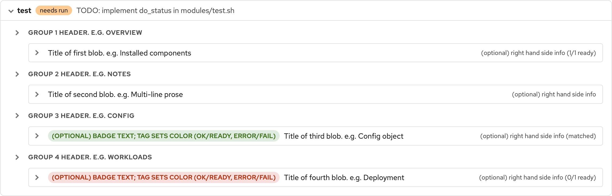

# How to add a module

A **module** is one setup step for the demo lab. Examples include configuring registry integrations and installing the Compliance Operator. The web GUI and the command-line orchestrator (`scripts/acs-setup.sh`) both call the same module scripts with the same flags.

| Flag | What the module must do |
|------|-------------------------|
| `--help` | Explain the purpose of the module, what it depends on, which environment variables it needs, and what `--run` and `--uninstall` change. |
| `--status` | Report whether this step is already done. Print both a short summary line and detailed Status folds (described later). Both outputs are required. |
| `--run` | Apply the step. Running it again when nothing has drifted must still succeed. |
| `--run --dry-run` | Describe what `--run` would change, without changing the cluster or Central. |
| `--uninstall` | Remove what this module created, or refuse with a clear error. |
| `--uninstall --dry-run` | Describe what `--uninstall` would remove, or refuse the same way. |

## What you must create

A module appears in the GUI and the orchestrator only when both of the following exist:

1. An executable script at `modules/<id>.sh`.
2. A matching row in `config/modules.json`.

The orchestrator discovers modules only from `config/modules.json`, then runs `modules/<id>.sh`. A catalog row without a script still appears in the GUI as **not installed**, which is useful for placeholders. A script with no catalog row is invisible to both the GUI and the orchestrator.

## Fast path

The commands below create a new module from the skeleton and run a first smoke test:

```bash
# 1. Choose a short kebab-case id, for example my-feature
ID=my-feature

# 2. Copy the shell skeleton (always required)
cp templates/module-skeleton.sh "modules/${ID}.sh"
chmod +x "modules/${ID}.sh"

# 3. Edit the copy: set MODULE_ID, fill in usage() and the do_* functions.
#    Search for TODO. The skeleton’s emit_status_sections() is the teaching
#    example for Status folds; replace it with real lab checks when ready.

# 4. Add a row to config/modules.json (see “Catalog entry” below).
#    Without that row, the module will not appear in the GUI.

# 5. Smoke-test from the terminal
./modules/${ID}.sh --help
./modules/${ID}.sh --status
./scripts/acs-setup.sh --status --module "${ID}"
```

Copy Status folds from `templates/module-skeleton.sh`. Keep that file open while you write your own `emit_status_sections()`.

## Catalog entry

Add one object to the `modules` array in `config/modules.json`. The array order is the order shown in the GUI and the default order for a full install. If this module must run after another module, put that module’s `id` in `dependsOn`.

Below is a minimal catalog row:

```json
{
  "id": "my-feature",
  "label": "Short description for the Description column",
  "dependsOn": []
}
```

Follow these rules when you fill in that object:

- `id` is the module key. It must match the script name `modules/<id>.sh`, the CLI `--module` value, entries in other modules’ `dependsOn` lists, and the **Module** column in the GUI. Do not repeat the id inside `label`.
- `label` is human text for the Description column only. Use a plain sentence or phrase, capitalized at the start. Do not write `id - description`.
- Do not put a number prefix on the filename. Prefer `my-feature.sh` over `07-my-feature.sh`.

## Optional Python helper

Most modules remain a single shell script. Put `oc` checks and straightforward logic in the `do_*` functions inside `modules/<id>.sh`.

Add a Python helper only when bash is a poor fit. The usual cases are Central HTTP calls and heavy JSON work. The commands below copy the helper template for id `my-feature`. The helper filename uses underscores instead of hyphens:

```bash
cp templates/module-helper.py modules/my_feature.py
```

In `modules/my-feature.sh`, uncomment the “Optional: call a Python helper” block from the skeleton and set `HELPER` to `modules/my_feature.py`. Keep `--help` and flag parsing in the shell script. Put the heavy work in the `.py` file.

If you are unsure whether you need Python, stay in bash until the shell version becomes hard to maintain.

## Status output (required)

`--status` must print two machine-readable results. Order does not matter. Extra log lines on stdout or stderr are fine.

1. A **summary line** in tab-separated values (TSV) form.
2. Exactly one **Status folds** line that starts with `ACS_SECTIONS_JSON=`.

If the Status folds line is missing, the Status card shows “No section details.” If the TSV summary is missing or unusable, the Modules table and the Status header have no sensible badge or message to display.

### Summary line (TSV)

**Tab-separated values (TSV)** means the fields on the line are separated by a single tab character, not by commas or spaces.

The summary line has three fields: module `id`, `state`, and a short human `message`. Below is an example:

```text
my-feature	ok	short human summary
```

Below is the same line written in bash:

```bash
printf '%s\t%s\t%s\n' "$MODULE_ID" "ok" "short human summary"
```

The orchestrator keeps the last line that contains at least three tab-separated fields.

| State | Meaning |
|-------|---------|
| `ok` | This step is already in good shape. |
| `needs-run` | The lab is reachable, but this step is missing or has drifted. |
| `error` | The module cannot decide (for example, bad credentials or an API that is down). |

In the rest of this guide, **TSV summary** means that three-field tab-separated line.

The TSV summary fills the badge and message in the Modules table, and the module header row in the Status card (id, state badge, and message). It does not fill the grouped folds under that header. Those folds come from Status folds.

### Status folds (`ACS_SECTIONS_JSON`)

Status folds are a small presentation language built for this project. Your module does not draw PatternFly widgets. It emits structured facts, and the GUI turns those facts into grouped, expandable rows under the module.

One `--status` run therefore feeds three consumers:

- the CLI result from `./scripts/acs-setup.sh --status --json`
- the Modules table, through the TSV summary
- the detailed Status card, through `ACS_SECTIONS_JSON`

#### Why this exists

Modules are mostly bash, sometimes with a thin Python helper. Authors need a format they can emit with `jq` or `json.dumps`, not a front-end SDK.

A TSV summary alone is enough for one badge and one sentence. It is not enough when a module has many independent checks. Compliance Operator status routinely includes dozens of facts.

Other approaches fall short here:

- Putting Markdown or HTML in the TSV `message` couples modules to GUI escaping. It also gives you no reliable grouping, expand and collapse, badges, or typed JSON bodies.
- Dumping a free-form log into Status is hard to scan.
- Shipping a UI toolkit from each module is too heavy for shell authors and would fork the look of the product.
- Large external schemas such as SARIF or full Kubernetes condition trees are oversized for “is this demo step ready?” and are painful to emit from bash.

This repo therefore uses a narrow JSON schema on one machine line. That design keeps three properties in balance:

- The schema is small enough to teach from `templates/module-skeleton.sh`.
- It is rich enough for groups, folds, optional badges, right-hand summaries, and prose or JSON bodies.
- Presentation stays in the GUI, and modules stay data producers.

Only two body formats are supported on purpose: `prose` and `json`. Treat Status folds as a tiny report format, not as a general markup language.

#### How it looks in the GUI

The screenshot below shows the teaching folds from the skeleton after a Status refresh. Group headers sit on the left with an expand-all caret. Each fold is indented under its group. Optional `tag` and `tagLabel` values become colored badges. Optional `summary` text sits on the right side of the fold row.



There is also an interactive field map. It uses the same Status CSS as the live GUI and labels each visible piece with the field name that produced it (`group`, `title`, `summary`, `tag`, `tagLabel`, `body`, `bodyFormat`). Open that map while you edit `emit_status_sections()`, so you can match a key in your `jq` object to the UI element it controls.

After you start the GUI with `./serve.sh`, open the map in either of these ways:

- In the GUI, open the **?** help menu in the masthead and choose **Status folds field map**.
- Or open [gui/static/status-sections-map.html](gui/static/status-sections-map.html) in the browser at [http://127.0.0.1:8765/static/status-sections-map.html](http://127.0.0.1:8765/static/status-sections-map.html). If `./serve.sh` printed a different port, use that port instead.

#### Wire format

Print exactly one line: the prefix `ACS_SECTIONS_JSON=` followed by compact JSON. Build the JSON with `jq` or with Python `json.dumps`. Do not hand-escape a giant string inside `printf`.

Below is how you print that line:

```bash
printf 'ACS_SECTIONS_JSON=%s\n' "$sections_json"
```

Below is the root JSON object that `$sections_json` must contain:

```json
{ "sections": [ ]
}
```

Each element of `sections` is one fold. The table below lists every supported field:

| Field | Required? | Role in the UI |
|-------|-----------|----------------|
| `group` | Recommended | Heading above a batch of folds. Reuse the same string to keep items under one heading. A new string starts a new heading. The group row also gets an expand-all control for every fold in that batch. |
| `title` | Yes | Main label on the fold row. This is the text you click to expand the fold. |
| `summary` | No | Muted hint on the right side of the fold row. |
| `tag` / `tagLabel` | No | Badge to the left of `title`. `tag` chooses the color: `ok` or `ready` is green, `error` or `fail` is red, and anything else is warn. `tagLabel` is the visible badge text. If you omit `tagLabel`, the GUI falls back to `tag`. |
| `body` | Yes | Content shown when the fold is expanded. |
| `bodyFormat` | No | `prose` (the default) renders ordinary text and turns newlines into line breaks. `json` renders a pretty-printed monospace block from an object, an array, or a JSON string. |

#### Skeleton example

The file `templates/module-skeleton.sh` includes an `emit_status_sections()` function that teaches the Status folds shape. It shows four groups: ordinary prose, multi-line prose, JSON with an ok badge, and JSON with an error badge. Copy that function into your module, then replace the sample data with real checks against the lab.

Below is a short version of the same emit pattern. It is abbreviated on purpose. Open the skeleton for the complete teaching set, including the badge and JSON examples:

```bash
emit_status_sections() {
  local sections_json prose_multiline
  prose_multiline="$(cat <<'EOF'
Body of a multi-line prose blob.
Each newline becomes a line break in the GUI.
EOF
  )"
  sections_json="$(
    jq -nc --arg prose_multi "$prose_multiline" '{
      sections: [
        {
          group: "Group 1 header. e.g. Overview",
          title: "Title of first blob. e.g. Installed components",
          summary: "(optional) right hand side info (1/1 ready)",
          body: "Body of the first blob...",
          bodyFormat: "prose"
        },
        {
          group: "Group 2 header. e.g. Notes",
          title: "Title of second blob. e.g. Multi-line prose",
          summary: "(optional) right hand side info",
          body: $prose_multi,
          bodyFormat: "prose"
        }
      ]
    }'
  )"
  printf 'ACS_SECTIONS_JSON=%s\n' "$sections_json"
}

do_status() {
  emit_status_sections
  printf '%s\tok\tshort human summary\n' "$MODULE_ID"
}
```

`jq` is already required by the orchestrator. Prefer `--arg` and `--argjson` for dynamic values instead of interpolating shell text into the `jq` program.

For a large real-world example of the same schema, see the Compliance Operator overview emitter in `scripts/compliance_co_overview.py`.

## Run, dry-run, and uninstall

Keep these behaviors in mind when you implement `--run` and `--uninstall`:

- `--run` should leave the lab in the desired state. Running it again when nothing has drifted should still succeed.
- `--run --dry-run` should describe the plan and exit 0 without changing the cluster or Central.
- `--uninstall` should remove what this module owns. Prefer cleanup that is safe when the resources are already gone.
- If uninstall is not safe or not defined, refuse: print a clear message, emit a TSV summary with state `error`, and exit non-zero. Do not pretend success.
- Orchestrator uninstall always requires `--module <id>`. There is no CLI path that uninstalls every module at once.
- On hard failure, exit non-zero and print a clear message on stderr.

## Credentials and ACS style

Do not invent a second credential path:

- For Central, use `lib/central.py`.
- For OpenShift, use `lib/openshift.py`. That helper reads `lab-credentials.json`; it does not use `~/.kube/config`.

If the RHACS UI configures something in Central, prefer the Central API. Avoid applying lower-level cluster objects that bypass Central when Central already owns that feature. Compliance scan schedules are the usual example.

## Verify end-to-end

The commands below exercise status, dry-run, run, uninstall dry-run, and the GUI:

```bash
./scripts/acs-setup.sh --status --module my-feature
./scripts/acs-setup.sh --run --module my-feature --dry-run
./scripts/acs-setup.sh --run --module my-feature
./scripts/acs-setup.sh --uninstall --module my-feature --dry-run
./serve.sh
```

In the GUI you should see an enabled Modules row, a sensible Status view after refresh, and Run and Uninstall actions on the row menu. The Dry run toggle applies to both actions.

## Contributing

Open a pull request with the `config/modules.json` entry and `modules/<id>.sh`. Include a helper `.py` file only if you added one. There is no plugin store and no auto-discovery of scripts outside the catalog. Private experiments can use the same layout on your machine. Share them with a pull request when they are useful beyond your lab.
