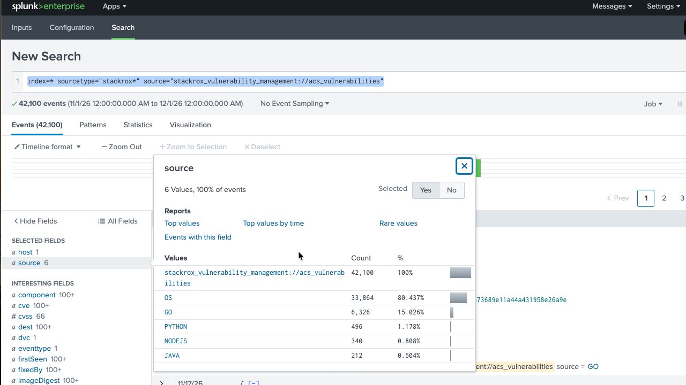

# Splunk + RHACS Technology Add-on demo

Feature: Splunk SIEM lab with RHACS TA  
Module: `splunk-TA`

## Before you start

- Lab credentials have working OpenShift admin access (`oc` via this tool).
- [`helm`](https://helm.sh/docs/intro/install/) on PATH (on macOS: `brew install helm`).
- RHACS TA `.spl` on disk (see [Install the Technology Add-on package](#install-the-technology-add-on-package) below).

## Install the Technology Add-on package

The add-on is **not** in this git repo (Splunkbase license). Download it yourself:

1. Open [Splunkbase app 5315 - Red Hat Advanced Cluster Security](https://splunkbase.splunk.com/app/5315) and sign in.
2. Download the Technology Add-on (Splunkbase saves it as a `.spl`; keep that filename).
3. Place it under `~/code/Splunk/` (or pass `--ta-dir`).

```bash
mkdir -p ~/code/Splunk
# copy the downloaded .spl into ~/code/Splunk/
./modules/splunk-TA.sh --run
```

Stack only (no TA yet): `./modules/splunk-TA.sh --run --skip-ta`

Product reference: [RHACS 5.0 - 15.3. Using the Red Hat Advanced Cluster Security for Kubernetes add-on](https://docs.redhat.com/en/documentation/red_hat_advanced_cluster_security_for_kubernetes/5.0/html-single/integrating/index#integrate-splunk-add-on_integrate-with-splunk).

## What the module sets up

1. Namespace `splunk-demo`.
2. Splunk Operator (Helm) + Standalone Splunk Free + PVCs + Route `splunk-web`.
3. Installs the RHACS Technology Add-on into the Splunk pod from your local `.spl`.

It does **not** configure Central endpoint, API token, or modular inputs in the Splunk UI - that is the configuration steps below.

## Configuration

1. Open Splunk Web (URL from module Status → Splunk Web Route).
2. You will be automatically logged in as the Splunk Admin.
3. Configure the Add-on Setting:
   1. Central endpoint as `host:443` (no `https://` prefix).
   2. Paste an RHACS API token (as Analyst).
4. Create New Input two times: ACS Vulnerability Management, ACS Violations.
   1. Change the index from `default` to `main`.
5. In the Add-on Search box, type `index=* sourcetype="stackrox*"`.
6. To see only violations type `index=* sourcetype="stackrox*" sourcetype="stackrox-violations"`.
7. To see only Vulnerability data type `index=* sourcetype="stackrox*" source="stackrox_vulnerability_management://acs_vulnerabilities"`.
8. You can play with other sources by clicking the `source` field under **SELECTED FIELDS**.



## Commands

```bash
./modules/splunk-TA.sh --help
./modules/splunk-TA.sh --status
./modules/splunk-TA.sh --run --dry-run
./modules/splunk-TA.sh --run
./modules/splunk-TA.sh --run --skip-ta
./modules/splunk-TA.sh --run --ta-dir /path/to/dir
./modules/splunk-TA.sh --uninstall --dry-run
./modules/splunk-TA.sh --uninstall
```

## Notes

- Uninstall removes Standalone, Helm release, and the namespace. Cluster-scoped Splunk Operator CRDs stay.
- Never commit passwords, API tokens, or the Splunkbase `.spl`.
